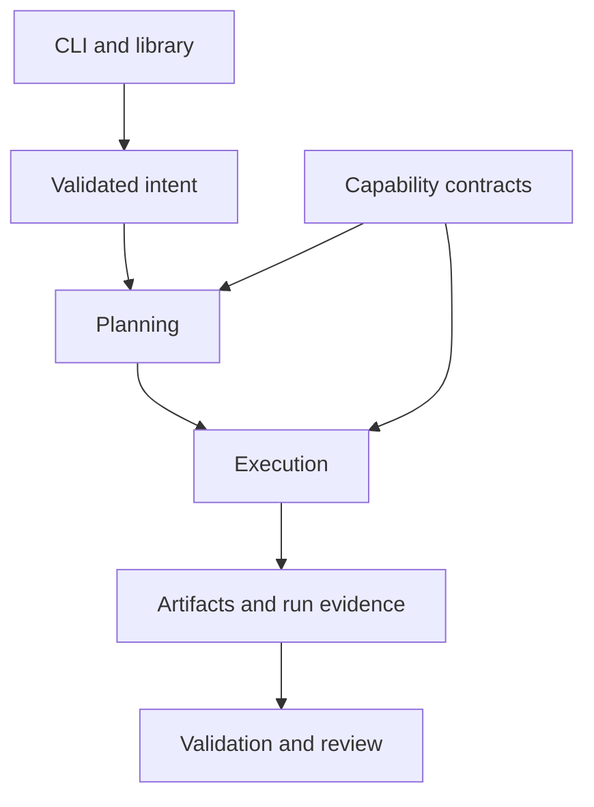

# Renderflow Architecture

## Purpose and scope

**Start here for the current architecture.** This document owns structural
boundaries, dependency direction and integration rules. [SYSTEM.md](SYSTEM.md)
owns logical responsibilities. The [implementation view](docs/architecture/overview.md)
maps those responsibilities to current source; the directory layout does not
define the conceptual architecture.

The root architecture documents use the repository's existing
`aether.architecture-document/v1` convention. Their `draft` status is retained;
this navigation correction does not ratify a new organization policy. The older
foundation documents under `docs/architecture/foundation/` remain historical
reference, with [current destinations](docs/architecture/overview.md#historical-foundation-documents)
and original contents preserved.

## Layer model

1. **Intent and contracts** — identity, policy, specifications, schemas, and accepted decisions.
2. **Domain** — canonical concepts and pure domain behavior.
3. **Application** — planning, orchestration, use cases, and state transitions.
4. **Adapters** — filesystems, providers, frameworks, renderers, and external tools.
5. **Interfaces** — CLI, library, site, reports, generated artifacts, and automation contracts.
6. **Evidence** — tests, diagnostics, provenance, manifests, and health projections.

Dependencies point inward toward stable contracts and domain behavior. External details do not become canonical domain truth.

## Structural view

This is a conceptual interaction view, not a call graph or proof that a route
is available. Interfaces share application behavior. Planning selects bounded
capabilities and records expected work; execution records what actually
happened. Artifact checks and human review remain distinct from plan intent,
provider success and telemetry.

The current ordinary build boundary dispatches to the existing format-graph
engine or the layered-composition engine. These engines retain their own
execution state and target identities. A locale/output branch is not reduced
to a format name, and a requested target is not a published derivative. The
[composition integration decision](docs/work/406/PLANNER_INTEGRATION.md) and
[artifact-forest contract](docs/architecture/derivative-forest.md) describe the
specific representations without introducing a second orchestration system.

## Dependency rules

- Sibling domain capabilities integrate through versioned public contracts, not direct access to internals.
- Generated artifacts never become the canonical source unless an accepted decision explicitly changes ownership.
- Provider and platform adapters depend on application ports; core behavior does not depend on a provider implementation.
- Read, plan, apply, verify, publish, and recover remain separate authority boundaries when consequential.
- Cross-repository references use releases, immutable commits, schemas, packages, or documented APIs rather than mutable default-branch assumptions.

## Ecosystem interfaces

Consumer projects own content, rights, translations and publication approval.
Renderflow owns generic static-artifact planning, rendering and evidence. Flow
owns cross-tool orchestration through released public interfaces; its
[Renderflow adapter](https://github.com/egohygiene/flow/issues/52) remains separate
work gated on a qualified immutable release. A source-tree import or a handoff
document is not that integration.

Provider adapters expose only declared directions and bounded capabilities.
Tool installation, model/font/assets, network policy, version identity and
validation belong to the selected route. An installed tool does not establish
every conversion it could theoretically perform. The
[provider contract](docs/provider-contract.md) and
[toolchain qualification record](docs/work/429/QUALIFICATION.md) make those
boundaries concrete.

## Deployment and portability

The architecture favors independently usable local and self-hosted operation. Optional managed services may add availability, collaboration, support, and hosted infrastructure without becoming the canonical holder of portable state.

## Evidence and evolution

- **Current source:** the workspace exposes reusable planning, execution,
  composition, provider and SDK contracts. Merged implementation is not a
  claim of passing runtime, visual, native-provider or platform qualification.
- **Draft-only work:** [PR #455](https://github.com/egohygiene/renderflow/pull/455)
  authors additional original-Fountain exports and transcript terminal Text;
  at this documentation checkpoint it is draft and unmerged.
- **Proposed release:** [#419](https://github.com/egohygiene/renderflow/issues/419)
  and the [release guide](docs/release-candidate.md) own the bounded first
  immutable publication candidate. A Cargo version does not establish a
  published or supported distribution.
- **Scheduled governance:** existing [decisions](DECISIONS.md) keep their
  four-digit identifiers. [#405](https://github.com/egohygiene/renderflow/issues/405)
  retains its shared-ADR-system scheduling gate;
  [#409](https://github.com/egohygiene/renderflow/issues/409) retains the later
  post-roadmap audit. Neither is activated by these documentation corrections.

Use the [live roadmap](https://github.com/egohygiene/renderflow/issues/367) for
current ordering and issue-specific qualification gaps. Historical checkpoints
in [ROADMAP.md](ROADMAP.md) retain their original dates and evidence limits.
