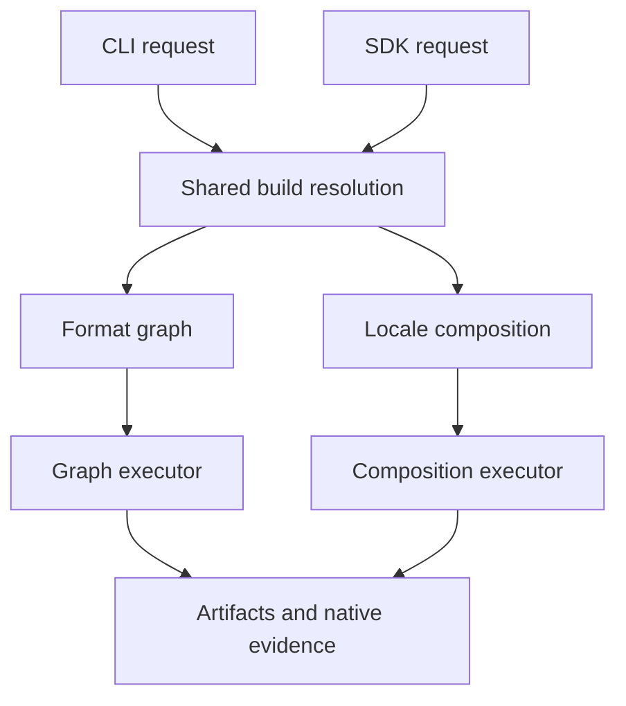

# Architecture and implementation navigation

The current architecture entry point is
[the root ARCHITECTURE.md](https://github.com/egohygiene/renderflow/blob/main/ARCHITECTURE.md).
It defines structural boundaries and dependency direction;
[root SYSTEM.md](https://github.com/egohygiene/renderflow/blob/main/SYSTEM.md)
defines logical responsibilities. This page supplies navigation and a source
map. Implementation paths explain where to contribute without defining the
conceptual architecture.

## Reading order

1. Read the root [purpose](https://github.com/egohygiene/renderflow/blob/main/PURPOSE.md),
   [principles](https://github.com/egohygiene/renderflow/blob/main/PRINCIPLES.md) and
   [foundations](https://github.com/egohygiene/renderflow/blob/main/FOUNDATIONS.md)
   for intent and invariants.
2. Read [SYSTEM.md](https://github.com/egohygiene/renderflow/blob/main/SYSTEM.md)
   and [ARCHITECTURE.md](https://github.com/egohygiene/renderflow/blob/main/ARCHITECTURE.md)
   for ownership and boundaries.
3. Select the relevant implementation contract below and follow its source map.
4. Use the [live roadmap](https://github.com/egohygiene/renderflow/issues/367)
   for current work and evidence gaps. Root
   [ROADMAP.md](https://github.com/egohygiene/renderflow/blob/main/ROADMAP.md)
   preserves dated implementation history.

The root documents retain their existing draft status. Navigation reconciliation
is not organization-policy ratification. Existing
[decisions](https://github.com/egohygiene/renderflow/blob/main/DECISIONS.md)
retain four-digit identifiers;
[#405](https://github.com/egohygiene/renderflow/issues/405) keeps its shared-ADR
scheduling gate. The separate post-roadmap audit remains
[#409](https://github.com/egohygiene/renderflow/issues/409).

## Current build path

Ordinary `build`, configuration `inspect`/`graph`, and the SDK share the
`planning::build` boundary. Resolution loads the specification once and
captures a `ResolvedBuild` using the graph or native composition engine.
Execution consumes that captured state. The CLI adapts arguments and reports
results; it does not own another renderer.

The composition plan's locale/output forest is authoritative for its branch
identities. A format-keyed projection cannot substitute for it. Graph-specific
resume/watch controls remain unavailable to composition; its optional derivative
cache is a separate reuse mechanism. The
[composition guide](../user-guide/page-composition.md) and
[integration decision](../work/406/PLANNER_INTEGRATION.md) record those limits.

Provider discovery, parsing and input capture may be part of planning for the
selected route. A plan or dry-run is not evidence that conversion, visual review
or publication succeeded. Native tool/version/asset qualification belongs to
that route's retained evidence.

## Source map

All paths below are relative to the repository root. Core paths live under
`crates/renderflow-core/src/`; there is no root `src/` directory.

| Responsibility | Current source locations |
| --- | --- |
| CLI executable | `crates/renderflow-cli/src/main.rs` delegates to the core application |
| CLI arguments and dispatch | `crates/renderflow-core/src/cli.rs`, `app.rs`, `commands/` |
| Public library/SDK | `crates/renderflow-core/src/lib.rs`, `sdk.rs` |
| Specification loading and policy | `crates/renderflow-core/src/spec.rs`, `spec/`, `config.rs` |
| Shared build resolution | `crates/renderflow-core/src/planning/build.rs`, `planning.rs`, `planning/build_composition.rs` |
| Graph paths, forest identity and execution | `crates/renderflow-core/src/graph/`, `planning/forest.rs` |
| Layered composition | `crates/renderflow-core/src/composition/`, `planning/composition.rs`, `planning/composition_evidence.rs` |
| Capability and tool inventory | `crates/renderflow-core/src/graph/capability.rs`, `toolchain.rs`, `creative_doctor.rs`, `transforms/yaml_loader.rs` |
| Built-in and external adapters | `crates/renderflow-core/src/adapters/`, `transforms/`, `strategies/`, `process.rs` |
| Creative source families | `crates/renderflow-core/src/screenplay/`, `timed_text/`, `speech/` |
| Ordered publication outputs | `crates/renderflow-core/src/publication/`, `print_pdf.rs`, `fixed_layout_epub.rs` |
| Artifact storage, caches and resume | `crates/renderflow-core/src/artifact/`, `cache.rs`, `checkpoint.rs` |
| Validation, hygiene and run evidence | `crates/renderflow-core/src/validation.rs`, `hygiene.rs`, `evidence.rs` |
| AI catalog, skills and transport | `crates/renderflow-core/src/ai/`, `transforms/ai.rs` |
| Plugin contract | `crates/renderflow-plugin-sdk/`; host integration in `crates/renderflow-core/src/transforms/plugin.rs` |
| Integration coverage | `crates/renderflow-core/tests/`, plus root `tests/` entries declared by crate manifests |
| Public contracts and examples | `schemas/`, `examples/`, `docs/` |
| Release and site tooling | `.github/workflows/release.yml`, `scripts/`, `apps/`; see the release guide before using legacy packaging helpers |

This map describes source present at the #459 checkpoint. It does not establish
that every path is compiled, executed or qualified. For setup and contribution
commands, see
[CONTRIBUTING.md](https://github.com/egohygiene/renderflow/blob/main/CONTRIBUTING.md).

## Contract and evidence navigation

| Question | Current reference |
| --- | --- |
| Which sources, policies and targets are admitted? | [Spec v2](../user-guide/spec-v2-reference.md), [ordered collections](../user-guide/ordered-collections.md) |
| How are routes, target identities and outputs related? | [Derivative forest](derivative-forest.md), [execution evidence](../execution-evidence.md) |
| How does composition preserve locale/layout/render evidence? | [Page composition](../user-guide/page-composition.md), [#406 handoff](../work/406/HANDOFF.md) |
| Which creative directions are declared and qualified? | [Capability matrix](../user-guide/creative-capabilities.md), [toolchain qualification](../work/429/QUALIFICATION.md), [#430 handoff](../work/430/HANDOFF.md) |
| How may another tool invoke and verify Renderflow? | [Provider/checkpoint contract](../provider-contract.md), [Flow handoff](flow-artifact-forest.md) |
| What can be installed as a supported release? | [Integration-candidate gate](../release-candidate.md), [#419](https://github.com/egohygiene/renderflow/issues/419) |

**Source, qualification and release are different states.** The merged
composition and creative checkpoints contain authored implementation with
remaining runtime/visual/native qualification. At this checkpoint
[PR #455](https://github.com/egohygiene/renderflow/pull/455) is draft and unmerged;
its original-Fountain exports and transcript terminal Text are not main
capabilities. The proposed `v0.3.0-rc.1` version is not a published artifact.
Flow's [adapter issue](https://github.com/egohygiene/flow/issues/52) requires a
qualified immutable release and owns downstream consumer proof.

## Historical foundation documents

The older pages retain their original text and dates for reference. Their
navigation ownership is superseded by the corresponding root documents; do
not update both copies as competing current specifications.

| Historical page | Current owner |
| --- | --- |
| [Methodology](foundation/METHODOLOGY.md) | [Root METHODOLOGY.md](https://github.com/egohygiene/renderflow/blob/main/METHODOLOGY.md) |
| [Foundations](foundation/FOUNDATIONS.md) | [Root FOUNDATIONS.md](https://github.com/egohygiene/renderflow/blob/main/FOUNDATIONS.md) |
| [System](foundation/SYSTEM.md) | [Root SYSTEM.md](https://github.com/egohygiene/renderflow/blob/main/SYSTEM.md) |
| [Architecture](foundation/ARCHITECTURE.md) | [Root ARCHITECTURE.md](https://github.com/egohygiene/renderflow/blob/main/ARCHITECTURE.md) |
| [Roadmap](foundation/ROADMAP.md) | [Root ROADMAP.md](https://github.com/egohygiene/renderflow/blob/main/ROADMAP.md) and the [live issue ledger](https://github.com/egohygiene/renderflow/issues/367) |

The remaining knowledge-base topic pages and detailed implementation articles
are retained reference material. Their old code examples or capability claims
must be read against current source, contract versions and issue evidence. This
checkpoint does not move the knowledge base, rewrite its historical decisions
or complete the later full documentation/audit sweep.
