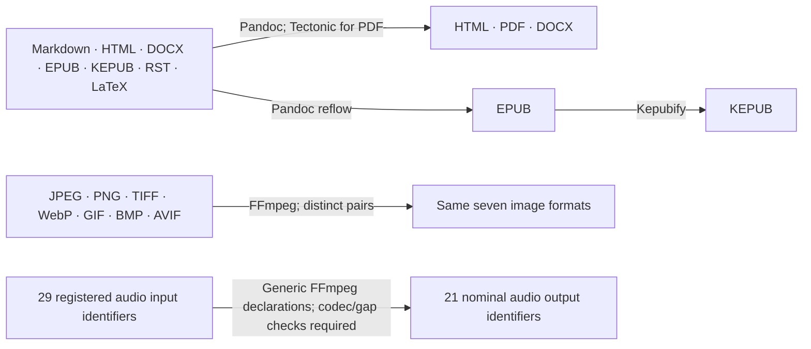
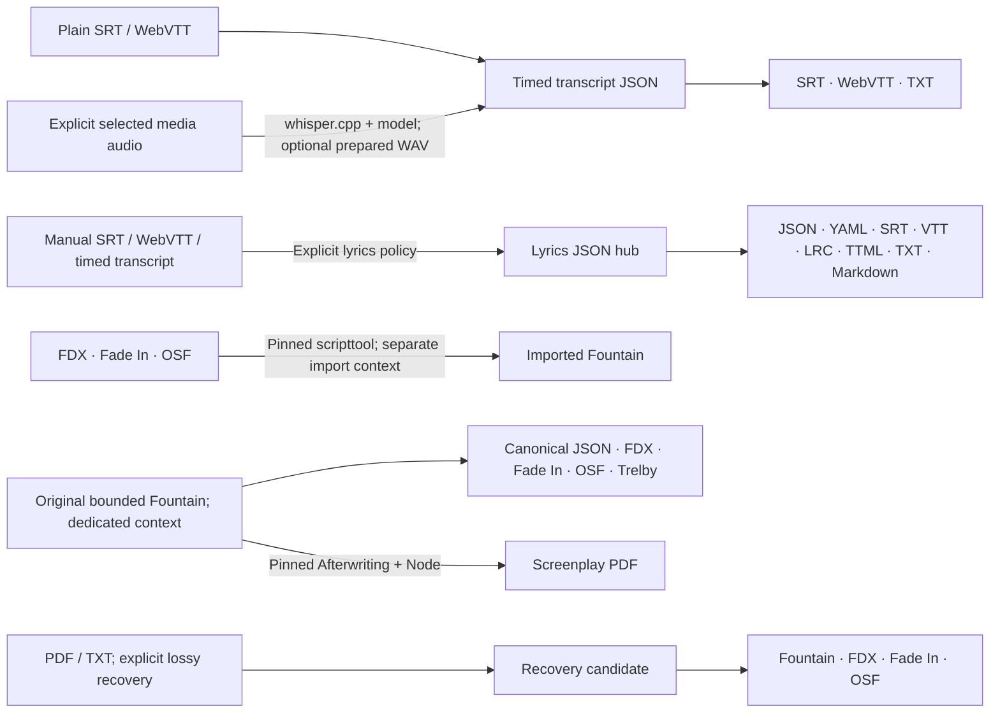
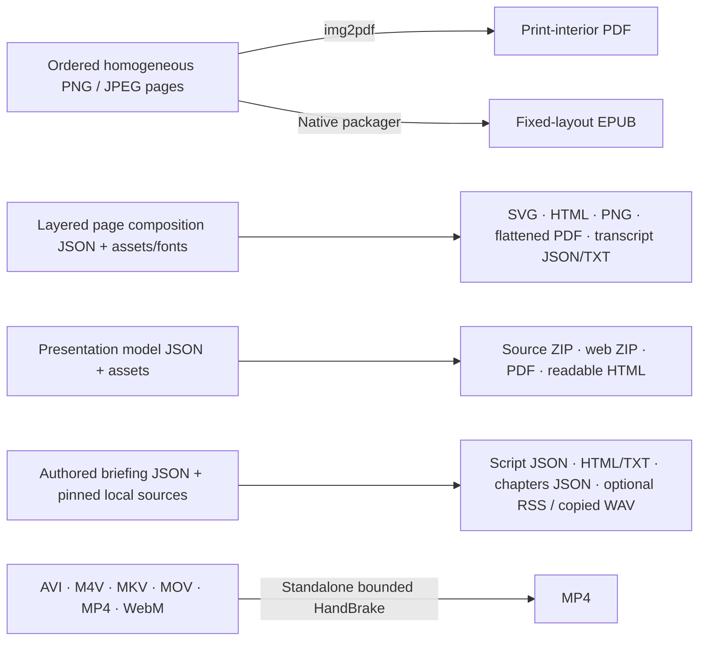

# Renderflow conversion map

Source snapshot: **9 November 2026**, main commit
[`9bfb494`](https://github.com/egohygiene/renderflow/tree/9bfb49446f6cf570af01e33412b48cbd4ff03763).

[Searchable offline map](conversion-map.html) · [Exact direction inventory (CSV)](conversion-map.csv) · [Source-backed snapshot (JSON)](conversion-map.json)

Download the HTML file and open it locally to filter by input, output, family and
execution surface. It embeds the same inventory and needs no service or network.
GitHub renders this Markdown overview; it displays HTML source rather than running it.

This maps the source that exists now. Providers, model/assets, codec availability,
output fidelity and release qualification have **not** been exercised here.
The canonical builder registers **656 ordinary directed declarations**: 25
document edges, EPUB→KEPUB, 42 image edges and 588 audio edges. That number
includes generic provider mappings and flagged MIDI/raw-PCM/BWF gaps. It is not a
count of tested, locally available or successful conversions.

Opt-in profiles, standalone operations, lower-level SDK calls, scoped chains and
report/package outputs are listed separately. Their inventories overlap; do not
add them into a universal conversion count. Source arrays and codec flags were
read as text; no Renderflow command, repository generator, tool discovery,
provider/media/model run, browser, test, build, validator or CI was executed.

## Family overview

These diagrams group families for readability. The tables and exact CSV rows
define directions, required contexts and exclusions. Separate contexts cannot
be composed merely because two arrows share a filename extension.

## Ordinary document routes

The canonical builder's exact destination sets below exclude same-format edges.
Pandoc handles document conversion; PDF additionally requires Tectonic. KEPUB
generation is a separate EPUB→KEPUB step. RST/LaTeX are ordinary inputs here;
their presence in the format registry does not add ordinary output edges.
KEPUB is a canonical v2/SDK input mapped to EPUB; the older v1 `input_format`
parser still has only its six document variants.

| Input | Direct ordinary outputs | Additional scoped chain |
|---|---|---|
| `markdown` | `html`, `pdf`, `docx`, `epub` | via EPUB → KEPUB |
| `html` | `pdf`, `docx`, `epub` | via EPUB → KEPUB |
| `docx` | `html`, `pdf`, `epub` | via EPUB → KEPUB |
| `epub` | `html`, `pdf`, `docx` | EPUB → KEPUB is direct |
| `kepub` | `html`, `pdf`, `docx`, `epub` | Same-format source retention is not a conversion |
| `rst` | `html`, `pdf`, `docx`, `epub` | via EPUB → KEPUB |
| `latex` | `html`, `pdf`, `docx`, `epub` | via EPUB → KEPUB |

Source: [planning.rs:3718](https://github.com/egohygiene/renderflow/blob/9bfb49446f6cf570af01e33412b48cbd4ff03763/crates/renderflow-core/src/planning.rs#L3718); [adapters/strategy.rs:274](https://github.com/egohygiene/renderflow/blob/9bfb49446f6cf570af01e33412b48cbd4ff03763/crates/renderflow-core/src/adapters/strategy.rs#L274); [adapters/strategy.rs:261](https://github.com/egohygiene/renderflow/blob/9bfb49446f6cf570af01e33412b48cbd4ff03763/crates/renderflow-core/src/adapters/strategy.rs#L261).

## Ordinary image routes

Every **distinct pair** in this set is registered through FFmpeg:

`jpeg`, `png`, `tiff`, `webp`, `gif`, `bmp`, `avif`.

That is 42 declared directions. Provider support and the selected profile still
control actual decoding/encoding, color, metadata, transparency and animation.
SVG/HEIC/PSD and extended image codec names do not gain these stock build edges.
The lower-level image strategy's 35 nominal target identifiers are listed later.

Source: [planning.rs:3718](https://github.com/egohygiene/renderflow/blob/9bfb49446f6cf570af01e33412b48cbd4ff03763/crates/renderflow-core/src/planning.rs#L3718); [adapters/strategy.rs:274](https://github.com/egohygiene/renderflow/blob/9bfb49446f6cf570af01e33412b48cbd4ff03763/crates/renderflow-core/src/adapters/strategy.rs#L274); [image/ffmpeg.rs:62](https://github.com/egohygiene/renderflow/blob/9bfb49446f6cf570af01e33412b48cbd4ff03763/crates/renderflow-core/src/image/ffmpeg.rs#L62).

## Ordinary audio declarations

Source identifiers (29):

`wav`, `aiff`, `bwf`, `pcm`, `flac`, `m4a_alac`, `wv`, `ape`, `tta`, `dsf`, `dff`, `shn`, `mp3`, `m4a`, `aac`, `ogg`, `opus`, `wma`, `amr`, `mp2`, `ra`, `oma`, `ac3`, `ec3`, `thd`, `dts`, `dtshd`, `midi`, `mod`.

Nominal output identifiers (21):

`wav`, `aiff`, `bwf`, `pcm`, `flac`, `m4a_alac`, `wv`, `ape`, `tta`, `mp3`, `m4a`, `aac`, `ogg`, `opus`, `wma`, `amr`, `mp2`, `ac3`, `ec3`, `dts`, `midi`.

The builder creates each distinct input/output pair whose destination has a
non-`None` codec mapping. The CSV records all 588 declarations and flags:

- **MIDI source or destination:** the generic strategy maps `midi` to FFmpeg
  strings, without a dedicated symbolic-MIDI transcriber/synthesizer. These 48
  declarations are a mapping gap, not established audio↔MIDI capability.
- **Raw PCM source:** the generic input argv supplies no explicit raw demuxer,
  sample rate or channel count. A `.pcm` extension cannot supply that clock;
  the inventory flags these source directions for a bounded input adapter.
- **All other provider mappings:** selected FFmpeg builds must provide the
  decoder, encoder and compatible muxer. Codec flags in Rust do not prove
  local availability or fidelity; unusual/optional encoders need qualification.
- **BWF destination:** the codec mapping is WAV/PCM without an explicit `bext`
  authoring route. Broadcast metadata conformance is not established by that flag.

`m4a` means AAC; `m4a_alac` means ALAC. The shared `.m4a` suffix alone does not
identify the selected codec. DSF/DFF/SHN/RA/OMA/THD/DTS-HD/MOD have no ordinary
encoding target. Their source declarations still depend on an actual decoder.

Source: [planning.rs:3718](https://github.com/egohygiene/renderflow/blob/9bfb49446f6cf570af01e33412b48cbd4ff03763/crates/renderflow-core/src/planning.rs#L3718); [adapters/strategy.rs:274](https://github.com/egohygiene/renderflow/blob/9bfb49446f6cf570af01e33412b48cbd4ff03763/crates/renderflow-core/src/adapters/strategy.rs#L274); [audio/format.rs:166](https://github.com/egohygiene/renderflow/blob/9bfb49446f6cf570af01e33412b48cbd4ff03763/crates/renderflow-core/src/audio/format.rs#L166); [audio/ffmpeg.rs:59](https://github.com/egohygiene/renderflow/blob/9bfb49446f6cf570af01e33412b48cbd4ff03763/crates/renderflow-core/src/audio/ffmpeg.rs#L59).

## Manual lyrics: the Akashic path

An explicitly authored **SRT** is enough to enter the dedicated manual-lyrics
profile. WebVTT and typed timed-transcript JSON are its other inputs:

`SRT / VTT / timed transcript JSON → lyrics JSON → YAML / SRT / VTT / LRC / TTML / TXT / Markdown`

The hub itself is also an output. Timings, words and classification/review
declarations come from the caller. LRC/TTML representability is bounded; exports
record losses. TXT/Markdown omit timing. The profile does not transcribe, align,
add chords or create an automatic-review decision. LRC/TTML/YAML output does not
establish a reverse reader. See [the manual lyrics guide](manual-lyrics.md).

Plain subtitle conversion has a separate timed-transcript hub and exports only
SRT, VTT and TXT. Existing embedded subtitles are extracted from selected streams;
optional speech recognition is a different explicit operation. Aniflow owns the
captioned-video finishing pipeline; these Renderflow routes produce text files.

## Complete grouped inventory

`source_registered` means a concrete source adapter/profile exists, unqualified
here. `provider_dependent` retains generic provider mappings. `sdk_only` requires
the lower-level public API; it is not an ordinary build route. `definitions_only`,
`configured_only` and `recognition_only` do not establish stock converters.
Expanded rows can additionally carry `mapping_gap` flags. The JSON links every
group to exact source lines and source-file hashes at the pinned revision.
The CSV's `group` column joins `groups[].id` in the JSON for full requirements,
limits and source citations, avoiding repeated prose and URLs on every row.

### Documents & ebooks

**Document conversion** (`documents.pandoc`; source_registered)

`markdown`, `html`, `docx`, `epub`, `kepub`, `rst`, `latex` → `html`, `pdf`, `docx`, `epub`.

Surface: Build / SDK. Providers: Pandoc, Tectonic for PDF.

Selection: Ordinary build targets; compatible installed tools and selected execution policy.

Bounds: No same-format edge. RST/LaTeX are inputs here; Markdown, RST and LaTeX are not ordinary built-in output targets. Reflow EPUB, not fixed-layout EPUB. KEPUB input is treated as EPUB.

Source: [planning.rs:3718](https://github.com/egohygiene/renderflow/blob/9bfb49446f6cf570af01e33412b48cbd4ff03763/crates/renderflow-core/src/planning.rs#L3718); [adapters/strategy.rs:274](https://github.com/egohygiene/renderflow/blob/9bfb49446f6cf570af01e33412b48cbd4ff03763/crates/renderflow-core/src/adapters/strategy.rs#L274); [adapters/strategy.rs:261](https://github.com/egohygiene/renderflow/blob/9bfb49446f6cf570af01e33412b48cbd4ff03763/crates/renderflow-core/src/adapters/strategy.rs#L261).

**EPUB to Kobo EPUB** (`ebooks.kepub`; source_registered)

`epub` → `kepub`.

Surface: Build / SDK. Providers: Kepubify.

Selection: Request kepub; exact .kepub.epub derivative.

Bounds: Established reflow EPUB path. Fixed-layout EPUB → KEPUB is not supported by the fixed-layout profile.

Source: [planning.rs:3718](https://github.com/egohygiene/renderflow/blob/9bfb49446f6cf570af01e33412b48cbd4ff03763/crates/renderflow-core/src/planning.rs#L3718); [strategies/ebook.rs:91](https://github.com/egohygiene/renderflow/blob/9bfb49446f6cf570af01e33412b48cbd4ff03763/crates/renderflow-core/src/strategies/ebook.rs#L91).

**Document to Kobo EPUB through reflow EPUB** (`ebooks.reflow.chain`; source_registered)

`markdown`, `html`, `docx`, `rst`, `latex` → `kepub`.

Within this context, via `epub`.

Surface: Build / SDK. Providers: Pandoc, Kepubify.

Selection: Request kepub; planner retains the intermediate EPUB.

Bounds: A scoped documented chain, not a new direct converter.

Source: [planning.rs:3718](https://github.com/egohygiene/renderflow/blob/9bfb49446f6cf570af01e33412b48cbd4ff03763/crates/renderflow-core/src/planning.rs#L3718).

**Editorial article presentation** (`documents.editorial`; source_registered)

`markdown` → `html`, `pdf`, `docx`, `epub`.

Surface: Build / SDK. Providers: Pandoc >=3.6.1, Tectonic for PDF, Bundled templates/fonts.

Selection: Select editorial-v1 preset and article frontmatter.

Bounds: Structured article subset, source/local assets and declared fonts. This is a presentation preset over the document route, not arbitrary Markdown generation or an autonomous writing agent.

Source: [strategies/editorial.rs:97](https://github.com/egohygiene/renderflow/blob/9bfb49446f6cf570af01e33412b48cbd4ff03763/crates/renderflow-core/src/strategies/editorial.rs#L97).

### Images

**Seven-format image conversion** (`images.ffmpeg`; provider_dependent)

`jpeg`, `png`, `tiff`, `webp`, `gif`, `bmp`, `avif` → `jpeg`, `png`, `tiff`, `webp`, `gif`, `bmp`, `avif`.

Surface: Build / SDK. Providers: FFmpeg.

Selection: Ordinary image target with selected quality/profile.

Bounds: Every distinct pair is registered. Actual decoder/encoder availability, animation flattening, color, transparency and metadata fidelity depend on selected provider/profile; no native qualification performed.

Source: [planning.rs:3718](https://github.com/egohygiene/renderflow/blob/9bfb49446f6cf570af01e33412b48cbd4ff03763/crates/renderflow-core/src/planning.rs#L3718); [adapters/strategy.rs:274](https://github.com/egohygiene/renderflow/blob/9bfb49446f6cf570af01e33412b48cbd4ff03763/crates/renderflow-core/src/adapters/strategy.rs#L274); [image/ffmpeg.rs:62](https://github.com/egohygiene/renderflow/blob/9bfb49446f6cf570af01e33412b48cbd4ff03763/crates/renderflow-core/src/image/ffmpeg.rs#L62).

### Audio

**Generic audio conversion declarations** (`audio.ffmpeg`; provider_dependent)

`wav`, `aiff`, `bwf`, `pcm`, `flac`, `m4a_alac`, `wv`, `ape`, `tta`, `dsf`, `dff`, `shn`, `mp3`, `m4a`, `aac`, `ogg`, `opus`, `wma`, `amr`, `mp2`, `ra`, `oma`, `ac3`, `ec3`, `thd`, `dts`, `dtshd`, `midi`, `mod` → `wav`, `aiff`, `bwf`, `pcm`, `flac`, `m4a_alac`, `wv`, `ape`, `tta`, `mp3`, `m4a`, `aac`, `ogg`, `opus`, `wma`, `amr`, `mp2`, `ac3`, `ec3`, `dts`, `midi`.

Surface: Build / SDK. Providers: FFmpeg.

Selection: Ordinary audio target and selected audio profile.

Bounds: These are source-registered FFmpeg mappings, not measured working pairs. Build-specific codecs must exist. Raw PCM input has no self-describing clock; generic argv does not add raw-input -f/-ar/-ac. Symbolic MIDI mappings have no dedicated transcription/synthesis adapter and are flagged separately.

Source: [planning.rs:3718](https://github.com/egohygiene/renderflow/blob/9bfb49446f6cf570af01e33412b48cbd4ff03763/crates/renderflow-core/src/planning.rs#L3718); [adapters/strategy.rs:274](https://github.com/egohygiene/renderflow/blob/9bfb49446f6cf570af01e33412b48cbd4ff03763/crates/renderflow-core/src/adapters/strategy.rs#L274); [audio/format.rs:166](https://github.com/egohygiene/renderflow/blob/9bfb49446f6cf570af01e33412b48cbd4ff03763/crates/renderflow-core/src/audio/format.rs#L166); [audio/ffmpeg.rs:59](https://github.com/egohygiene/renderflow/blob/9bfb49446f6cf570af01e33412b48cbd4ff03763/crates/renderflow-core/src/audio/ffmpeg.rs#L59).

### Lyrics & subtitles

**Plain subtitles to timed transcript** (`subtitles.import`; source_registered)

`srt`, `vtt` → `timed_transcript_json`.

Surface: Build / standalone / SDK. Providers: In-process codecs.

Selection: Build: execution.subtitles. Standalone: subtitles convert.

Bounds: Plain UTF-8 cues with millisecond timing; rich styling/markup/cue settings are refused. Generic JSON and untimed text are not substitutes for the transcript schema.

Source: [planning.rs:3266](https://github.com/egohygiene/renderflow/blob/9bfb49446f6cf570af01e33412b48cbd4ff03763/crates/renderflow-core/src/planning.rs#L3266); [timed_text/codec.rs:6](https://github.com/egohygiene/renderflow/blob/9bfb49446f6cf570af01e33412b48cbd4ff03763/crates/renderflow-core/src/timed_text/codec.rs#L6).

**Timed transcript exports** (`subtitles.export`; source_registered)

`timed_transcript_json` → `srt`, `vtt`, `text`.

Surface: Build / standalone / SDK. Providers: In-process codecs.

Selection: Build: execution.subtitles. Standalone: subtitles convert.

Bounds: Text is a terminal export and loses timing/cue identity; companion evidence retains losses. No text→timed-subtitle inference.

Source: [planning.rs:3266](https://github.com/egohygiene/renderflow/blob/9bfb49446f6cf570af01e33412b48cbd4ff03763/crates/renderflow-core/src/planning.rs#L3266); [timed_text/codec.rs:142](https://github.com/egohygiene/renderflow/blob/9bfb49446f6cf570af01e33412b48cbd4ff03763/crates/renderflow-core/src/timed_text/codec.rs#L142).

**SRT and WebVTT interchange** (`subtitles.roundtrip`; source_registered)

`srt`, `vtt` → `srt`, `vtt`, `text`.

Within this context, via `timed_transcript_json`.

Surface: Build / standalone / SDK. Providers: In-process codecs.

Selection: Plain subtitle conversion; retain canonical transcript and disclosed losses.

Bounds: Build uses the timed_transcript_json hub. Standalone can reserialize the same format. No rich subtitle preservation claim.

Source: [planning.rs:3266](https://github.com/egohygiene/renderflow/blob/9bfb49446f6cf570af01e33412b48cbd4ff03763/crates/renderflow-core/src/planning.rs#L3266); [commands/subtitles.rs:21](https://github.com/egohygiene/renderflow/blob/9bfb49446f6cf570af01e33412b48cbd4ff03763/crates/renderflow-core/src/commands/subtitles.rs#L21).

**Extract an existing plain subtitle stream** (`subtitles.extract`; source_registered)

`mkv`, `webm`, `mp4`, `mov` → `timed_transcript_json`.

Surface: Build / standalone / SDK. Providers: FFprobe, FFmpeg.

Selection: Select an explicit global subtitle stream index; execution.subtitles for build.

Bounds: Only the admitted plain textual stream profile. Unsupported rich/image subtitles refuse; this does not recognize speech or create lyrics from audio.

Source: [planning.rs:3266](https://github.com/egohygiene/renderflow/blob/9bfb49446f6cf570af01e33412b48cbd4ff03763/crates/renderflow-core/src/planning.rs#L3266); [timed_text/graph.rs:149](https://github.com/egohygiene/renderflow/blob/9bfb49446f6cf570af01e33412b48cbd4ff03763/crates/renderflow-core/src/timed_text/graph.rs#L149).

**Extracted subtitle derivatives** (`subtitles.extract.exports`; source_registered)

`mkv`, `webm`, `mp4`, `mov` → `srt`, `vtt`, `text`.

Within this context, via `timed_transcript_json`.

Surface: Build / standalone / SDK. Providers: FFprobe, FFmpeg, In-process codecs.

Selection: Explicit selected existing subtitle stream.

Bounds: Scoped extraction/export chain. Text drops timestamps. Source-container timing and extraction scope stay explicit.

Source: [planning.rs:3266](https://github.com/egohygiene/renderflow/blob/9bfb49446f6cf570af01e33412b48cbd4ff03763/crates/renderflow-core/src/planning.rs#L3266).

**Additional standalone subtitle container suffixes** (`subtitles.standalone.aliases`; source_registered)

`mka`, `m4v` → `timed_transcript_json`, `srt`, `vtt`, `text`.

Surface: Standalone / SDK. Providers: FFprobe, FFmpeg, In-process codecs.

Selection: subtitles extract with an explicitly selected existing plain-text subtitle stream.

Bounds: The standalone filename adapter also accepts MKA/M4V. The canonical graph has no distinct MKA/M4V nodes; do not promote these suffixes into new build graph edges.

Source: [timed_text/provider.rs:367](https://github.com/egohygiene/renderflow/blob/9bfb49446f6cf570af01e33412b48cbd4ff03763/crates/renderflow-core/src/timed_text/provider.rs#L367).

**Manually authored timed lyrics hub** (`lyrics.normalize`; source_registered)

`srt`, `vtt`, `timed_transcript_json` → `lyrics_json`.

Surface: Build / SDK. Providers: In-process codecs.

Selection: Dedicated execution.lyrics policy; exact source SHA, explicit classification/review declarations.

Bounds: Manual timings are required. No ASR, alignment, automatic approval or LRC/TTML/YAML input parsing.

Source: [planning/lyrics.rs:46](https://github.com/egohygiene/renderflow/blob/9bfb49446f6cf570af01e33412b48cbd4ff03763/crates/renderflow-core/src/planning/lyrics.rs#L46); [lyrics/mod.rs:128](https://github.com/egohygiene/renderflow/blob/9bfb49446f6cf570af01e33412b48cbd4ff03763/crates/renderflow-core/src/lyrics/mod.rs#L128).

**Manual timed-lyrics derivatives** (`lyrics.export`; source_registered)

`srt`, `vtt`, `timed_transcript_json` → `lyrics_json`, `yaml`, `srt`, `vtt`, `text`, `markdown`, `lrc`, `ttml`.

Within this context, via `lyrics_json`.

Surface: Build / SDK. Providers: In-process codecs.

Selection: manual-timed-lyrics-v1 / execution.lyrics; reviewed means caller-declared review.

Bounds: Via lyrics_json hub. LRC precision/overlap/line limits and TTML subset can refuse unrepresentable content. TXT/Markdown lose timestamps; full classification/revision/section/provenance stays in companions. Output format names do not imply reverse readers.

Source: [planning/lyrics.rs:46](https://github.com/egohygiene/renderflow/blob/9bfb49446f6cf570af01e33412b48cbd4ff03763/crates/renderflow-core/src/planning/lyrics.rs#L46); [lyrics/mod.rs:128](https://github.com/egohygiene/renderflow/blob/9bfb49446f6cf570af01e33412b48cbd4ff03763/crates/renderflow-core/src/lyrics/mod.rs#L128).

**Re-export a validated lyrics document** (`lyrics.sdk`; sdk_only)

`lyrics_json` → `lyrics_json`, `yaml`, `srt`, `vtt`, `text`, `markdown`, `lrc`, `ttml`.

Surface: SDK only. Providers: In-process codecs.

Selection: lyrics::parse_document then lyrics::render; original model/policy validity required.

Bounds: The v2 manual-lyrics source gate still accepts only SRT, WebVTT and timed_transcript_json; YAML/LRC/TTML are not general input codecs.

Source: [lyrics/mod.rs:121](https://github.com/egohygiene/renderflow/blob/9bfb49446f6cf570af01e33412b48cbd4ff03763/crates/renderflow-core/src/lyrics/mod.rs#L121); [lyrics/mod.rs:167](https://github.com/egohygiene/renderflow/blob/9bfb49446f6cf570af01e33412b48cbd4ff03763/crates/renderflow-core/src/lyrics/mod.rs#L167).

### Speech

**Selected media stream to ASR WAV** (`speech.prepare`; source_registered)

`wav`, `flac`, `mp3`, `m4a_alac`, `m4a`, `aac`, `ogg`, `opus`, `mkv`, `webm`, `mp4`, `mov`, `avi` → `speech_pcm_wav`.

Surface: Standalone / SDK; internal build stage. Providers: Pinned FFprobe, Pinned FFmpeg.

Selection: Explicit global audio stream index and audio-preparation policy.

Bounds: Emits zero-origin mono 16 kHz PCM16 WAV for speech. This is intentional conversion, not lossless preservation or original-media alignment.

Source: [speech/policy.rs:225](https://github.com/egohygiene/renderflow/blob/9bfb49446f6cf570af01e33412b48cbd4ff03763/crates/renderflow-core/src/speech/policy.rs#L225); [speech/audio.rs:159](https://github.com/egohygiene/renderflow/blob/9bfb49446f6cf570af01e33412b48cbd4ff03763/crates/renderflow-core/src/speech/audio.rs#L159).

**Local speech recognition transcript** (`speech.recognize`; source_registered)

`wav`, `flac`, `mp3`, `m4a_alac`, `m4a`, `aac`, `ogg`, `opus`, `mkv`, `webm`, `mp4`, `mov`, `avi` → `timed_transcript_json`.

Surface: Build / standalone / SDK. Providers: Pinned whisper.cpp, Selected local model, FFmpeg/FFprobe when preparing audio.

Selection: execution.speech, AI permission and explicit provider/model pins; non-WAV needs audio preparation.

Bounds: Direct WAV input is the strict mono/16 kHz/PCM16 profile. Recognition is probabilistic and unreviewed; this is not automatic accurate singing/lyric alignment.

Source: [speech/policy.rs:225](https://github.com/egohygiene/renderflow/blob/9bfb49446f6cf570af01e33412b48cbd4ff03763/crates/renderflow-core/src/speech/policy.rs#L225); [planning.rs:3620](https://github.com/egohygiene/renderflow/blob/9bfb49446f6cf570af01e33412b48cbd4ff03763/crates/renderflow-core/src/planning.rs#L3620).

**Recognition transcript derivatives** (`speech.exports`; source_registered)

`wav`, `flac`, `mp3`, `m4a_alac`, `m4a`, `aac`, `ogg`, `opus`, `mkv`, `webm`, `mp4`, `mov`, `avi` → `srt`, `vtt`, `text`.

Within this context, via `timed_transcript_json`.

Surface: Build / standalone / SDK. Providers: whisper.cpp + model, FFmpeg/FFprobe for selected preparation, In-process codecs.

Selection: Same explicit speech selection; one shared recognition result.

Bounds: Scoped recognition/export chain. Prepared audio starts at zero. Original-media timing needs a separate operator time-map; text loses cue timing.

Source: [speech/policy.rs:225](https://github.com/egohygiene/renderflow/blob/9bfb49446f6cf570af01e33412b48cbd4ff03763/crates/renderflow-core/src/speech/policy.rs#L225); [planning.rs:3266](https://github.com/egohygiene/renderflow/blob/9bfb49446f6cf570af01e33412b48cbd4ff03763/crates/renderflow-core/src/planning.rs#L3266).

**Additional standalone audio-preparation suffixes** (`speech.standalone.aliases`; source_registered)

`mka`, `m4v`, `oga` → `speech_pcm_wav`, `timed_transcript_json`, `srt`, `vtt`, `text`.

Surface: Standalone / SDK. Providers: Pinned FFprobe, Pinned FFmpeg, whisper.cpp + model when recognizing.

Selection: Explicit audio stream selection; standalone speech transcribe audio-preparation path.

Bounds: These extra filename suffixes are admitted by the standalone preparation adapter, not distinct canonical graph nodes. Transcript exports additionally invoke selected ASR; prepared WAV starts at zero.

Source: [speech/audio.rs:328](https://github.com/egohygiene/renderflow/blob/9bfb49446f6cf570af01e33412b48cbd4ff03763/crates/renderflow-core/src/speech/audio.rs#L328).

**Export a saved result with supplied time mapping** (`speech.align`; source_registered)

`saved_speech_bundle_and_time_map` → `timed_transcript_json`, `srt`, `vtt`, `text`.

Surface: Standalone / SDK. Providers: In-process mapping/codecs.

Selection: Pinned saved result plus explicit operator original-media time-map and digests.

Bounds: No automatic forced alignment or new ASR. Synchronization remains operator-asserted and unreviewed.

Source: [commands/speech.rs:51](https://github.com/egohygiene/renderflow/blob/9bfb49446f6cf570af01e33412b48cbd4ff03763/crates/renderflow-core/src/commands/speech.rs#L51).

### Screenplays

**Original Fountain body exports** (`screenplay.body`; source_registered)

`fountain` → `screenplay_json`, `fdx`, `fadein`, `osf`, `trelby`.

Surface: Build / SDK. Providers: In-process body codecs.

Selection: execution.screenplay_body with explicit allow_unqualified.

Bounds: Original Fountain only; bounded body elements. Title pages, dual dialogue, extensions and unrepresentable semantics refuse. No chained import-to-export route.

Source: [planning/screenplay_body.rs:69](https://github.com/egohygiene/renderflow/blob/9bfb49446f6cf570af01e33412b48cbd4ff03763/crates/renderflow-core/src/planning/screenplay_body.rs#L69).

**Native screenplay import to Fountain** (`screenplay.import`; source_registered)

`fdx`, `fadein`, `osf` → `fountain`.

Surface: Build / standalone / SDK. Providers: Pinned scripttool.

Selection: execution.screenplay or screenplay convert; explicit source hash, tool hash/version and unqualified opt-in.

Bounds: Only these three import directions are adopted. No automatic reverse conversion or native-import→PDF/body-export chain.

Source: [planning.rs:3526](https://github.com/egohygiene/renderflow/blob/9bfb49446f6cf570af01e33412b48cbd4ff03763/crates/renderflow-core/src/planning.rs#L3526); [screenplay/provider.rs:145](https://github.com/egohygiene/renderflow/blob/9bfb49446f6cf570af01e33412b48cbd4ff03763/crates/renderflow-core/src/screenplay/provider.rs#L145).

**Original Fountain to screenplay PDF** (`screenplay.pdf`; source_registered)

`fountain` → `pdf`.

Surface: Build / standalone / SDK. Providers: Pinned Node.js, Pinned Afterwriting package.

Selection: execution.screenplay_pdf / screenplay pdf; exact local installation and allow_unqualified.

Bounds: Strict original ASCII Fountain; fixed A4 or US Letter profiles. Original-source-only, exactly one PDF target. Native/import/recovery intermediate chains are not auto-admitted.

Source: [planning.rs:3374](https://github.com/egohygiene/renderflow/blob/9bfb49446f6cf570af01e33412b48cbd4ff03763/crates/renderflow-core/src/planning.rs#L3374).

**Recover a screenplay candidate** (`screenplay.recover`; source_registered)

`pdf`, `text` → `screenplay_recovery_candidate`.

Surface: Build / standalone / SDK. Providers: In-process heuristics, pdftotext for PDF, Optional pdftoppm + Tesseract + language data.

Selection: Explicit execution.screenplay_recovery / screenplay recover policy and unqualified opt-in.

Bounds: Lossy, heuristic, review-required recovery. OCR is optional fallback for pages lacking usable text, not a generic searchable-PDF writer.

Source: [planning/screenplay_recovery.rs:60](https://github.com/egohygiene/renderflow/blob/9bfb49446f6cf570af01e33412b48cbd4ff03763/crates/renderflow-core/src/planning/screenplay_recovery.rs#L60).

**Recovered body derivatives** (`screenplay.recover.exports`; source_registered)

`pdf`, `text` → `fountain`, `fdx`, `fadein`, `osf`.

Within this context, via `screenplay_recovery_candidate`.

Surface: Build / standalone / SDK. Providers: Recovery providers, In-process bounded writers.

Selection: Same dedicated recovery context; preserve candidate and extraction evidence.

Bounds: Via validated recovery candidate. Does not reconstruct original formatting or imply creative/native-application approval. Trelby and PDF re-export are outside this recovery profile.

Source: [planning/screenplay_recovery.rs:60](https://github.com/egohygiene/renderflow/blob/9bfb49446f6cf570af01e33412b48cbd4ff03763/crates/renderflow-core/src/planning/screenplay_recovery.rs#L60); [screenplay/recovery/export.rs:91](https://github.com/egohygiene/renderflow/blob/9bfb49446f6cf570af01e33412b48cbd4ff03763/crates/renderflow-core/src/screenplay/recovery/export.rs#L91).

**Read native body into canonical screenplay model** (`screenplay.sdk.parse`; sdk_only)

`fountain`, `fdx`, `fadein`, `osf`, `trelby` → `screenplay_json`.

Surface: SDK only. Providers: In-process parsers.

Selection: screenplay::native::parse_native; caller may serialize the returned validated model.

Bounds: Bounded body parser, not an arbitrary native conversion CLI/build edge. Registration does not grant full-document/native fidelity.

Source: [screenplay/native.rs:86](https://github.com/egohygiene/renderflow/blob/9bfb49446f6cf570af01e33412b48cbd4ff03763/crates/renderflow-core/src/screenplay/native.rs#L86).

### Publishing & layouts

**Ordered image pages to print-interior PDF** (`publishing.print`; source_registered)

`png_collection`, `jpeg_collection` → `pdf`.

Surface: Build / SDK. Providers: Pinned img2pdf 0.6.3.

Selection: Explicit ordered homogeneous image collection, geometry and execution.print_pdf_interior.

Bounds: No SVG input, mixed-format collection, implicit directory order or PDF/X/press qualification. Page order/boxes and source image streams are bounded.

Source: [planning.rs:3163](https://github.com/egohygiene/renderflow/blob/9bfb49446f6cf570af01e33412b48cbd4ff03763/crates/renderflow-core/src/planning.rs#L3163).

**Ordered image pages to fixed-layout EPUB** (`publishing.fixed_epub`; source_registered)

`png_collection`, `jpeg_collection` → `epub_fixed_layout`.

Surface: Build / SDK. Providers: In-process EPUB packager, Optional EPUBCheck.

Selection: execution.fixed_layout_epub plus publication contract and declared order/geometry.

Bounds: Exact homogeneous PNG or JPEG collection. SVG input and fixed-layout KEPUB are refused; no arbitrary document→fixed-layout EPUB claim.

Source: [planning.rs:3133](https://github.com/egohygiene/renderflow/blob/9bfb49446f6cf570af01e33412b48cbd4ff03763/crates/renderflow-core/src/planning.rs#L3133).

**Localized layered page outputs** (`composition.structural`; source_registered)

`page_composition` → `svg`, `html`, `composition_transcript_json`, `composition_transcript_text`.

Surface: Build / standalone / SDK. Providers: In-process composition/typography.

Selection: Typed page-composition JSON and pinned local assets/fonts, explicit locales and supported targets.

Bounds: A page model with exact layers/text/reading order is required. Transcript JSON is distinct from timed-transcript JSON. This is not arbitrary JSON→SVG/HTML or generic SVG conversion.

Source: [composition/mod.rs:59](https://github.com/egohygiene/renderflow/blob/9bfb49446f6cf570af01e33412b48cbd4ff03763/crates/renderflow-core/src/composition/mod.rs#L59); [planning/build.rs:136](https://github.com/egohygiene/renderflow/blob/9bfb49446f6cf570af01e33412b48cbd4ff03763/crates/renderflow-core/src/planning/build.rs#L136).

**Composed page to flattened PNG or PDF** (`composition.raster`; source_registered)

`page_composition` → `png`, `pdf`.

Surface: Build / standalone / SDK. Providers: In-process bounded raster/PDF providers.

Selection: Explicit PNG/PDF targets, native raster/PDF settings and pinned local assets/fonts.

Bounds: Single-page flattened output. Supported source raster assets are pinned PNG/JPEG under the composition contract. No editable PSD/ORA/IDML export, color-managed CMYK, spot colors or PDF/X claim.

Source: [composition/mod.rs:78](https://github.com/egohygiene/renderflow/blob/9bfb49446f6cf570af01e33412b48cbd4ff03763/crates/renderflow-core/src/composition/mod.rs#L78); [docs/user-guide/page-composition.md:274](https://github.com/egohygiene/renderflow/blob/9bfb49446f6cf570af01e33412b48cbd4ff03763/docs/user-guide/page-composition.md#L274).

**Presentation source package and readable companion** (`presentation.source`; source_registered)

`presentation_model` → `presentation_source_zip`, `html`.

Surface: Build / standalone / SDK. Providers: In-process source packager.

Selection: Typed renderflow.presentation/v1 JSON, reviewed local assets and source selection.

Bounds: Source ZIP contains slides.md, style/layout and assets. HTML is a static readable companion. Original speaker notes are excluded from source by default; no arbitrary Markdown deck import.

Source: [presentation/render.rs:172](https://github.com/egohygiene/renderflow/blob/9bfb49446f6cf570af01e33412b48cbd4ff03763/crates/renderflow-core/src/presentation/render.rs#L172).

**Presentation to interactive web package or PDF** (`presentation.render`; source_registered)

`presentation_model` → `presentation_web_zip`, `pdf`.

Surface: Build / standalone / SDK. Providers: Prepared pinned Slidev 53.0.0 runtime/browser.

Selection: Explicit compatible local provider and allow_unqualified; web/PDF targets.

Bounds: Fixed 16:9 model and prepared assets. No PPTX/Keynote export, video deck, arbitrary Vue/JS, remote assets or installer during publication.

Source: [presentation/render.rs:131](https://github.com/egohygiene/renderflow/blob/9bfb49446f6cf570af01e33412b48cbd4ff03763/crates/renderflow-core/src/presentation/render.rs#L131).

**Authored local briefing to readable outputs** (`briefing.text`; source_registered)

`briefing_model` → `briefing_script_json`, `text`, `html`, `briefing_chapters_json`.

Surface: Build / standalone / SDK. Providers: In-process briefing renderer.

Selection: Typed briefing JSON, exact local source snapshots/citations and author-written chapter text.

Bounds: No repository fetching or automatic script summarization. Freshness, rights and review remain declared.

Source: [publication/briefing/mod.rs:116](https://github.com/egohygiene/renderflow/blob/9bfb49446f6cf570af01e33412b48cbd4ff03763/crates/renderflow-core/src/publication/briefing/mod.rs#L116).

**Briefing feed generation** (`briefing.feed`; source_registered)

`briefing_model_with_feed` → `rss`.

Surface: Build / standalone / SDK. Providers: In-process RSS writer and WAV inspector.

Selection: Explicit feed fields; narration requires a supplied script-bound recording.

Bounds: WAV attachment is copied, not synthesized/transcoded. Strict mono/16 kHz/PCM16 <=10 min. WAV appears only when supplied; RSS only when selected. No podcast upload or TTS.

Source: [publication/briefing/mod.rs:109](https://github.com/egohygiene/renderflow/blob/9bfb49446f6cf570af01e33412b48cbd4ff03763/crates/renderflow-core/src/publication/briefing/mod.rs#L109).

**Package supplied briefing narration** (`briefing.narration`; source_registered)

`briefing_model_with_narration` → `copied_narration_wav`.

Surface: Build / standalone / SDK. Providers: In-process copy and WAV inspector.

Selection: An explicitly supplied exact script-bound narration file.

Bounds: Copies the selected mono/16 kHz/PCM16 <=10-minute WAV. It does not synthesize, recognize, transcode or independently align narration.

Source: [publication/briefing/mod.rs:109](https://github.com/egohygiene/renderflow/blob/9bfb49446f6cf570af01e33412b48cbd4ff03763/crates/renderflow-core/src/publication/briefing/mod.rs#L109).

### Video

**Bounded standalone MP4 transcode** (`video.handbrake`; source_registered)

`avi`, `m4v`, `mkv`, `mov`, `mp4`, `webm` → `mp4`.

Surface: Standalone / SDK. Providers: HandBrakeCLI >=1.6.0.

Selection: video transcode / typed HandBrake request; one of four allowlisted presets.

Bounds: MP4 output only. Fast 720p30, Fast 1080p30, Creator 1080p60 or Production Standard. Not a generic build video graph; video repair/interpolation/music-video assembly remains Aniflow-owned.

Source: [video/handbrake.rs:495](https://github.com/egohygiene/renderflow/blob/9bfb49446f6cf570af01e33412b48cbd4ff03763/crates/renderflow-core/src/video/handbrake.rs#L495); [docs/handbrake-adapter.md:23](https://github.com/egohygiene/renderflow/blob/9bfb49446f6cf570af01e33412b48cbd4ff03763/docs/handbrake-adapter.md#L23).

### Lower-level SDK

**Extended image output strategy** (`sdk.images`; sdk_only)

`provider_decodable_image` → `jpeg`, `jpg`, `png`, `webp`, `avif`, `gif`, `bmp`, `tiff`, `tif`, `exr`, `hdr`, `dpx`, `cin`, `fits`, `fit`, `tga`, `sgi`, `rgb`, `pcx`, `pbm`, `pgm`, `ppm`, `pnm`, `pam`, `xbm`, `xpm`, `wbmp`, `ras`, `sun`, `jp2`, `j2k`, `jxl`, `apng`, `dds`, `ico`.

Surface: SDK only. Providers: FFmpeg build with selected codecs.

Selection: ImageStrategy / FfmpegImageArgs invoked explicitly by caller.

Bounds: 35 nominal output identifiers including aliases. Source decoding and encoder availability are provider-dependent. Ordinary build registers only the seven-image set; catalog recognition is not proof of decoder support.

Source: [image/format.rs:343](https://github.com/egohygiene/renderflow/blob/9bfb49446f6cf570af01e33412b48cbd4ff03763/crates/renderflow-core/src/image/format.rs#L343); [image/strategy.rs:31](https://github.com/egohygiene/renderflow/blob/9bfb49446f6cf570af01e33412b48cbd4ff03763/crates/renderflow-core/src/image/strategy.rs#L31).

**Audio output strategy and aliases** (`sdk.audio`; sdk_only)

`provider_decodable_audio` → `wav`, `bwf`, `aif`, `aiff`, `pcm`, `flac`, `m4a_alac`, `wv`, `ape`, `tta`, `mp3`, `m4a`, `aac`, `ogg`, `opus`, `wma`, `amr`, `mp2`, `ac3`, `ec3`, `dts`, `mid`, `midi`.

Surface: SDK only. Providers: FFmpeg build with selected codecs.

Selection: AudioStrategy / FfmpegAudioArgs invoked explicitly by caller.

Bounds: 23 nominal identifiers including aif/aiff and mid/midi aliases. MIDI declarations need a dedicated adapter; no native inference/synthesis is supplied by this strategy. PCM format/clock must be explicit outside the generic input argv.

Source: [audio/format.rs:166](https://github.com/egohygiene/renderflow/blob/9bfb49446f6cf570af01e33412b48cbd4ff03763/crates/renderflow-core/src/audio/format.rs#L166); [audio/strategy.rs:31](https://github.com/egohygiene/renderflow/blob/9bfb49446f6cf570af01e33412b48cbd4ff03763/crates/renderflow-core/src/audio/strategy.rs#L31).

**Explicit local image super-resolution** (`sdk.upscayl`; sdk_only)

`upscayl_decodable_image` → `png`, `jpeg`, `webp`.

Surface: SDK only. Providers: Upscayl NCNN, Complete model pair, Compatible local GPU/Vulkan runtime.

Selection: UpscaylExecutionRequest and selected materialized model/variant.

Bounds: Provider handles image decoding. Same-format derivative execution is not an ordinary canonical graph edge; planner only reports selected variants and its gating diagnostic. No implicit model install.

Source: [super_resolution.rs:757](https://github.com/egohygiene/renderflow/blob/9bfb49446f6cf570af01e33412b48cbd4ff03763/crates/renderflow-core/src/super_resolution.rs#L757); [planning.rs:947](https://github.com/egohygiene/renderflow/blob/9bfb49446f6cf570af01e33412b48cbd4ff03763/crates/renderflow-core/src/planning.rs#L947).

**Sample standard graph definitions** (`sdk.standard_definitions`; definitions_only)

`markdown` → `html`; `html` → `pdf`; `html` → `docx`; `markdown` → `pdf`; `markdown` → `docx`; `markdown` → `epub`; `markdown` → `rst`; `markdown` → `latex`.

Surface: SDK graph declarations. Providers: Caller-supplied compatible executors.

Selection: TransformDefinitionRegistry::with_standard_definitions.

Bounds: Definitions alone are not runtime converters. The canonical build starts from an empty graph/custom YAML then registers its real adapters; it does not execute the sample wkhtmltopdf/extra Pandoc definitions automatically.

Source: [graph/definition_registry.rs:103](https://github.com/egohygiene/renderflow/blob/9bfb49446f6cf570af01e33412b48cbd4ff03763/crates/renderflow-core/src/graph/definition_registry.rs#L103); [planning.rs:638](https://github.com/egohygiene/renderflow/blob/9bfb49446f6cf570af01e33412b48cbd4ff03763/crates/renderflow-core/src/planning.rs#L638).

### Evidence & packages

**Source artifact to descriptive DNA** (`evidence.dna`; source_registered)

`source_artifact` → `artifact_dna_json`, `artifact_dna_yaml`.

Surface: Standalone / SDK. Providers: In-process structural extractors, Explicit compatible AI extractor only if supplied.

Selection: dna extract with policy/source-size bounds; YAML is an inspection/materialization view.

Bounds: Descriptive observations, not a rendering/conversion to the original media type. Unknown/unsupported musical or visual semantics remain omitted. No model is selected by permission flags alone.

Source: [commands/dna.rs:16](https://github.com/egohygiene/renderflow/blob/9bfb49446f6cf570af01e33412b48cbd4ff03763/crates/renderflow-core/src/commands/dna.rs#L16); [dna.rs:692](https://github.com/egohygiene/renderflow/blob/9bfb49446f6cf570af01e33412b48cbd4ff03763/crates/renderflow-core/src/dna.rs#L692).

**Supplied WAV/evidence to Sonic description bundle** (`evidence.sonic`; source_registered)

`sonic_recipe` → `artifact_dna_json`, `sonic_description_json`, `markdown`, `sonic_guidance_json`.

Surface: Standalone / SDK. Providers: In-process Sonic/DNA/hygiene, Optional explicitly prepared model for structured evidence.

Selection: dna sonic plan/build with digest-pinned recipe and source/evidence.

Bounds: MAIN snapshot still accepts strict 16 kHz mono PCM16 WAV. Source-reported tempo/key/events and selected timed-text structure, not direct audio listening. Drafts #498/#499 extend admission/evidence only; no new format-conversion edges.

Source: [dna/sonic/mod.rs:200](https://github.com/egohygiene/renderflow/blob/9bfb49446f6cf570af01e33412b48cbd4ff03763/crates/renderflow-core/src/dna/sonic/mod.rs#L200).

**Reviewed synopsis to text and structured companion** (`evidence.summary`; source_registered)

`reviewed_summary` → `text`, `accepted_summary_json`.

Surface: Standalone / SDK. Providers: In-process reviewed export, Model only in separately selected candidate generation.

Selection: Exact accepted candidate/review/CAS records and supplied decision; ai summary export.

Bounds: No generic document→summary guarantee or automatic review. Export keeps structured references; plain text loses citation/coverage presentation.

Source: [publication/summary/review.rs:114](https://github.com/egohygiene/renderflow/blob/9bfb49446f6cf570af01e33412b48cbd4ff03763/crates/renderflow-core/src/publication/summary/review.rs#L114).

**Font registry to CSS declarations** (`evidence.fonts`; source_registered)

`font_registry` → `css`.

Surface: Standalone / SDK. Providers: In-process font-role resolution.

Selection: font css; typed JSON/YAML registry and local declared font assets.

Bounds: CSS generation/role resolution, not font binary conversion or embedding permission inference.

Source: [commands/font.rs:34](https://github.com/egohygiene/renderflow/blob/9bfb49446f6cf570af01e33412b48cbd4ff03763/crates/renderflow-core/src/commands/font.rs#L34).

**Native forest to portable evidence directory** (`evidence.portable`; source_registered)

`native_run_and_artifact_store` → `portable_forest_directory`.

Surface: Standalone / SDK. Providers: In-process verified copy/index writer.

Selection: bundle export with exact receipt digest, bundle and artifact-store roots.

Bounds: Copies retained evidence/payloads; not a generic ZIP/CBZ/TAR converter, public sanitation or upload. Sources remain external unless explicitly included by policy.

Source: [docs/user-guide/portable-forest-bundles.md:1](https://github.com/egohygiene/renderflow/blob/9bfb49446f6cf570af01e33412b48cbd4ff03763/docs/user-guide/portable-forest-bundles.md#L1).

**Render a resolved plan in different representations** (`reports.graph`; source_registered)

`resolved_build_plan` → `plan_text`, `plan_json`, `plan_yaml`, `plan_mermaid`, `plan_dot`, `plan_markdown`.

Surface: CLI / SDK reports. Providers: In-process plan renderers.

Selection: graph plan --format text/json/yaml/mermaid/dot/markdown; selected config and frozen plan.

Bounds: Reporting serialization of a typed plan, not a general JSON↔YAML/Markdown/file converter. Configured plan resolution can have its own provider preflight; none was invoked to create this map.

Source: [commands/graph.rs:50](https://github.com/egohygiene/renderflow/blob/9bfb49446f6cf570af01e33412b48cbd4ff03763/crates/renderflow-core/src/commands/graph.rs#L50).

**Analyze a bounded original Fountain body** (`reports.screenplay`; source_registered)

`fountain` → `screenplay_analysis_json`.

Surface: Standalone / SDK. Providers: In-process Fountain analyzer.

Selection: screenplay analyze; bounded supported Fountain body.

Bounds: Structural analysis/report only; it is distinct from scripttool JSON and from generating a PDF.

Source: [commands/screenplay_pdf.rs:22](https://github.com/egohygiene/renderflow/blob/9bfb49446f6cf570af01e33412b48cbd4ff03763/crates/renderflow-core/src/commands/screenplay_pdf.rs#L22).

### Configured extensions

**User-supplied conversion or collection route** (`custom.transforms`; configured_only)

`configured_format` → `configured_format`.

Surface: Configured command / plugin / AI. Providers: Explicit user-selected command/plugin/provider.

Selection: transforms YAML with a real executor; arbitrary supported graph-node pairs may be configured.

Bounds: Open-ended extension point, not stock conversion support. Examples, provider catalog entries and format enum variants do not establish a usable route; installation, argv, policy and validation are caller-owned.

Source: [docs/user-guide/transforms.md:23](https://github.com/egohygiene/renderflow/blob/9bfb49446f6cf570af01e33412b48cbd4ff03763/docs/user-guide/transforms.md#L23); [transforms/yaml_loader.rs:661](https://github.com/egohygiene/renderflow/blob/9bfb49446f6cf570af01e33412b48cbd4ff03763/crates/renderflow-core/src/transforms/yaml_loader.rs#L661).

### No stock route

**Generic structured-data interchange** (`not-stock.data`; recognition_only)

`json`, `yaml`, `toml`, `csv`, `tsv`, `xml` → `json`, `yaml`, `toml`, `csv`, `tsv`, `xml`.

Surface: Recognized / configured only. Providers: No implemented stock provider.

Selection: Requires a separately configured implemented transform.

Bounds: Specific typed JSON models and CLI report serialization are supported in their own contexts; no generic JSON↔YAML/TOML/CSV/XML stock converter is registered.

Source: [graph/format.rs:17](https://github.com/egohygiene/renderflow/blob/9bfb49446f6cf570af01e33412b48cbd4ff03763/crates/renderflow-core/src/graph/format.rs#L17); [planning.rs:3718](https://github.com/egohygiene/renderflow/blob/9bfb49446f6cf570af01e33412b48cbd4ff03763/crates/renderflow-core/src/planning.rs#L3718).

**Generic archive/comic conversion** (`not-stock.archives`; recognition_only)

`zip`, `tar.gz`, `tar.xz`, `cbz` → `zip`, `tar.gz`, `tar.xz`, `cbz`.

Surface: Recognized / configured only. Providers: No implemented stock provider.

Selection: Requires a separately configured implemented transform.

Bounds: Presentation ZIPs, EPUBs and portable evidence directories have exact package contracts. They do not establish arbitrary archive conversion or built-in image collection→CBZ.

Source: [graph/format.rs:17](https://github.com/egohygiene/renderflow/blob/9bfb49446f6cf570af01e33412b48cbd4ff03763/crates/renderflow-core/src/graph/format.rs#L17); [planning.rs:3718](https://github.com/egohygiene/renderflow/blob/9bfb49446f6cf570af01e33412b48cbd4ff03763/crates/renderflow-core/src/planning.rs#L3718).

**Rich subtitle or unsupported reverse input** (`not-stock.subtitle`; recognition_only)

`ass`, `ssa`, `ttml`, `lrc`, `text` → `timed_transcript_json`, `srt`, `vtt`.

Surface: Recognized / configured only. Providers: No implemented stock provider.

Selection: No stock input codec for these directions.

Bounds: TTML/LRC output exists only in the manual-lyrics profile. That does not add reverse readers. Untimed text has no inferred timestamps.

Source: [graph/format.rs:17](https://github.com/egohygiene/renderflow/blob/9bfb49446f6cf570af01e33412b48cbd4ff03763/crates/renderflow-core/src/graph/format.rs#L17); [timed_text/codec.rs:6](https://github.com/egohygiene/renderflow/blob/9bfb49446f6cf570af01e33412b48cbd4ff03763/crates/renderflow-core/src/timed_text/codec.rs#L6); [lyrics/mod.rs:128](https://github.com/egohygiene/renderflow/blob/9bfb49446f6cf570af01e33412b48cbd4ff03763/crates/renderflow-core/src/lyrics/mod.rs#L128).

**Editable layered/office/video targets** (`not-stock.editable`; recognition_only)

`page_composition` → `ora`; `page_composition` → `psd`; `page_composition` → `idml`; `presentation_model` → `pptx`; `presentation_model` → `keynote`; `video_source` → `mkv`; `video_source` → `webm`.

Surface: Recognized or deferred. Providers: No implemented stock provider.

Selection: No corresponding supported built-in output in these profiles.

Bounds: Composition recognizes ORA/PSD/IDML targets but marks them unsupported. Presentation supports source ZIP/web ZIP/PDF. Standalone HandBrake supports MP4 only. These are family-specific gaps, not claims about unrelated configured plugins.

Source: [composition/mod.rs:78](https://github.com/egohygiene/renderflow/blob/9bfb49446f6cf570af01e33412b48cbd4ff03763/crates/renderflow-core/src/composition/mod.rs#L78); [presentation/render.rs:23](https://github.com/egohygiene/renderflow/blob/9bfb49446f6cf570af01e33412b48cbd4ff03763/crates/renderflow-core/src/presentation/render.rs#L23); [video/handbrake.rs:495](https://github.com/egohygiene/renderflow/blob/9bfb49446f6cf570af01e33412b48cbd4ff03763/crates/renderflow-core/src/video/handbrake.rs#L495).

**Additional recognized image sources without stock build edges** (`not-stock.images`; recognition_only)

`svg`, `heic`, `heif`, `psd`, `eps`, `jxl` → `jpeg`, `png`, `webp`.

Surface: Recognized / configured or SDK only. Providers: No implemented stock provider.

Selection: No ordinary built-in image graph edge; a lower-level caller/configured adapter must supply a valid provider.

Bounds: Recognition, DNA inspection and the 35 SDK output codec flags do not supply these canonical build conversions. The composition profile consumes a page model; it does not rasterize arbitrary imported SVG/PSD/HEIC files.

Source: [planning.rs:3718](https://github.com/egohygiene/renderflow/blob/9bfb49446f6cf570af01e33412b48cbd4ff03763/crates/renderflow-core/src/planning.rs#L3718); [image/format.rs:343](https://github.com/egohygiene/renderflow/blob/9bfb49446f6cf570af01e33412b48cbd4ff03763/crates/renderflow-core/src/image/format.rs#L343).

## Lower-level codec flags and aliases

These are lower-level strategy declarations, beyond the narrower canonical
graph. Their existence does not qualify the source decoder or destination
encoder/muxer. Some entries are aliases, not additional unique file formats.

Image strategy nominal target identifiers (35):

`jpeg`, `jpg`, `png`, `webp`, `avif`, `gif`, `bmp`, `tiff`, `tif`, `exr`, `hdr`, `dpx`, `cin`, `fits`, `fit`, `tga`, `sgi`, `rgb`, `pcx`, `pbm`, `pgm`, `ppm`, `pnm`, `pam`, `xbm`, `xpm`, `wbmp`, `ras`, `sun`, `jp2`, `j2k`, `jxl`, `apng`, `dds`, `ico`.

Audio strategy nominal target identifiers including aliases (23):

`wav`, `bwf`, `aif`, `aiff`, `pcm`, `flac`, `m4a_alac`, `wv`, `ape`, `tta`, `mp3`, `m4a`, `aac`, `ogg`, `opus`, `wma`, `amr`, `mp2`, `ac3`, `ec3`, `dts`, `mid`, `midi`.

The ordinary graph and lower-level strategy are separate surfaces. In
particular, `TransformDefinitionRegistry::with_standard_definitions` is an SDK
sample registry, not the actual canonical builder's executor registration.

## Pending drafts and cross-repository scope

[Draft #498](https://github.com/egohygiene/renderflow/pull/498) broadens Sonic WAV
admission; [draft #499](https://github.com/egohygiene/renderflow/pull/499) adds
selected MIDI/stem **evidence** projection. They were pending when this snapshot
was authored. Neither adds a file-conversion edge, a MIDI generator, direct audio
understanding or an Aniflow media-finishing implementation to Renderflow.

Frame repair/upscale/RIFE, music-video assembly, caption burn-in/soft mux,
creator-metadata finishing and destination delivery live in Aniflow. Suite
orchestration belongs to Flow. This map does not silently import sibling tools'
capabilities into Renderflow.

## Keeping this snapshot honest

This dated map is a documentation view, not a second runtime registry. Use the
linked source registration/adapter functions for changes; recognized formats,
tool catalogs, example YAML and planned features are separate evidence. The
existing generated [format list](supported-formats.md) and
[creative capability matrix](creative-capabilities.md) retain their own owners.

When the conversion source changes, re-audit this snapshot's groups, exact CSV
directions, hashes and revision label together. User-supplied transforms/plugins
are open-ended and cannot be exhaustively enumerated from this checkout.
Actual local plan/provider/output and release qualification remain separate.
No new runtime acceptance, native success or CI result is claimed by this map.
