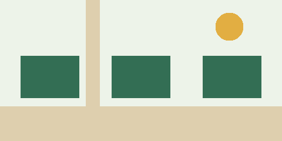

The first page of the garden notebook held three observations: the eastern bed
was dry, a gate hinge needed oil, and someone had left a clean watering can by
the shed. None of the entries proposed a grand plan. Each made the next visit
a little easier.

## Notice before changing

Rowan and Mira are fictional volunteers in a fictional garden. Their notebook
is a small example of how shared context can help people choose useful work;
it is not a report of a real experiment.

> "Leave enough detail for the next person to take one step."
>
> — Rowan, a fictional character in this example

An entry records **what was observed**, where it happened, and whether someone
already acted. The volunteers leave uncertain explanations as questions.[^notes]

::: {.callout}
**One practical rule:** Record an observation before proposing its cause.
:::

## Keep the handoff small

The volunteers agree on three habits:

1. Write the location in ordinary language.
2. Separate a completed action from a suggestion.
3. Leave the original observation visible when adding an update.

| Observation | Next action |
| --- | --- |
| Dry eastern bed | Check the soil before watering |
| Loose gate hinge | Bring the small screwdriver |
| Empty seed envelopes | Record the varieties already planted |

Their example record is intentionally plain:

```json
{
  "location": "eastern bed",
  "observation": "surface soil looks dry",
  "status": "needs a closer look"
}
```

The literal text `{{ observation }}` can appear in a note without becoming a
template instruction. The article's words remain content.

## Make room for the next reader



A short note gives the next visitor a starting point. A longer note can explain
why a suggestion was postponed. Both are useful when the writer makes the
difference clear.

::: {.aside}
**About this example:** All people, quotations, and events here are invented.
No empirical claims or external research citations are implied.
:::

The garden notebook did not need a new rule every week. It needed a place where
small observations could remain understandable. At the end of the month, that
was enough to make the next visit easier.

The [example address](https://example.invalid/) is deliberately non-resolving;
rendering retains the link and does not fetch it.

[^notes]: This footnote is part of the synthetic fixture and explains the
    notebook's convention. It is not an external citation.
